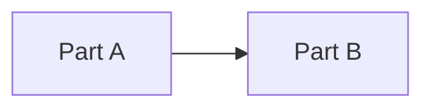

# System overview

SPIFFE-based configuration and secrets distribution for Kubernetes

## Parts

## Principles

- Files are the database.
- Defer detail until work is next up.
- Keep `wip/agents` current so any agent can resume.

## Decisions

- **The admin web interface is not a sub-project yet** (S-0018, 2026-11-06). `admin/` held a README and a CLAUDE.md and no code, and no story scheduled it, so a registered `sveltekit` component could be tagged and released empty (ADR-0001 retired `client-erlang` for the same reason). `admin` is removed from `system-flow.yaml`, `admin/` is deleted, and the plan is kept in [admin.md](admin.md). Scaffolding it is a separate epic.
