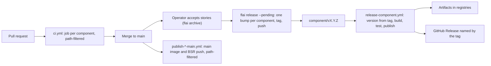

# Release and CI

How a change goes from an accepted story to a published artifact, per component. The
decision behind this flow is [ADR-0001](../adrs/0001-the-mono-repo-releases-from-flai-tags-per-component-with-github-actions.md);
the operator's steps are in [docs/operators/release.md](../../docs/operators/release.md).

## Flow

1. **Pull request.** `.github/workflows/ci.yml` runs one job per component, each
   path-filtered to the component's folder and calling `scripts/test-<component>.sh`, the
   same script `make test` runs, plus the system-flow check. These jobs are the required
   status checks on `main`.
2. **Acceptance.** The operator accepts a story; `flai archive` merges it and commits.
   Nothing is tagged or pushed at acceptance.
3. **Publish.** The operator runs `git fetch` then `flai release --pending`. For each
   component with accepted stories since its last tag, flai computes the bump from the
   natures of those stories (see `design/conventions/git.md`), writes an annotated tag
   `<component>/vX.Y.Z` whose annotation lists the items, and pushes the tags. A `research`
   story contributes nothing.
4. **Release.** `.github/workflows/release-<component>.yml` runs on `push` of
   `<component>/v*`. It strips the `<component>/v` prefix to get the version, writes that
   version into the package where the ecosystem needs one, builds and tests as CI does,
   publishes the artifacts in the table below, and creates a GitHub Release named by the
   tag with the tag annotation and the commits since the previous `<component>/v*` tag as
   its body. No workflow commits to `main`.
5. **Main-branch publishing.** Two workflows run on pushes to `main` filtered to their
   folder: the server's `main` image and the proto module's BSR push, which keeps external
   consumers current between releases.

## Components

Tags carry the component's `name` from `system-flow.yaml`. The version is the tag with
the `<component>/v` prefix removed. Credentials are GitHub Actions secrets of
`bytepunx/signet`, or OIDC trusted publishing where the registry supports it, in which
case the publisher is registered against this repository and the workflow filename below.

| Component | Workflow | Trigger | Artifacts | Registry | Credential |
|-----------|----------|---------|-----------|----------|------------|
| server | `release-server.yml` | `server/v*` | `signet-<os>-<arch>` CLI binaries and `sha256sums.txt` on the GitHub Release; `signetd` image tagged `vX.Y.Z`, `vX.Y`, and `latest`; Helm chart `signet` at version `X.Y.Z` | GitHub Releases; `ghcr.io/bytepunx/signetd` and `docker.io/bytepunx/signet`; `oci://ghcr.io/bytepunx/charts` | `GITHUB_TOKEN` (`packages: write`) for ghcr.io and the release; `DOCKERHUB_USERNAME` and `DOCKERHUB_TOKEN` for Docker Hub |
| server | `publish-server-main.yml` | push to `main`, paths `server/**` | `signetd` image tagged `main` | `ghcr.io/bytepunx/signetd`, `docker.io/bytepunx/signet` | As above |
| proto | `release-proto.yml` | `proto/v*` | BSR module labeled `vX.Y.Z`; GitHub Release | `buf.build/bytepunx/signet-proto`; GitHub Releases | `BSR_AUTH_TOKEN`; `GITHUB_TOKEN` |
| proto | `publish-proto-main.yml` | push to `main`, paths `proto/**` | BSR module at the commit | `buf.build/bytepunx/signet-proto` | `BSR_AUTH_TOKEN` |
| client-go | `release-client-go.yml` | `client-go/v*` | Go module `github.com/bytepunx/signet/client-go` at `client-go/vX.Y.Z`; GitHub Release | Go module proxy, from the tag itself | `GITHUB_TOKEN` for the release; the proxy needs none |
| client-python | `release-client-python.yml` | `client-python/v*` | wheel and sdist of `signet-client` | PyPI | Trusted publisher (OIDC) registered for `bytepunx/signet`, workflow `release-client-python.yml` |
| client-typescript | `release-client-typescript.yml` | `client-typescript/v*` | `@bytepunx/signet-client` package with provenance | npm | Trusted publisher (OIDC) registered for `bytepunx/signet`, workflow `release-client-typescript.yml` |
| client-rust | `release-client-rust.yml` | `client-rust/v*` | crate `signet-client` | crates.io | `CARGO_REGISTRY_TOKEN` |
| client-csharp | `release-client-csharp.yml` | `client-csharp/v*` | NuGet package `Signet.Client` | NuGet | Trusted publisher (OIDC) registered for `bytepunx/signet`, workflow `release-client-csharp.yml`, with `NUGET_USER` naming the account |
| client-elixir | `release-client-elixir.yml` | `client-elixir/v*` | Hex package `signet_client` | hex.pm | `HEX_API_KEY` |

Every release workflow also creates the GitHub Release; the table names the credential
only where it is not `GITHUB_TOKEN`.

## Versions in packages

A checked-in version field is a placeholder, never the released version. The release
workflow writes the tag's version before building:

| Component | Where the version lands at build time |
|-----------|---------------------------------------|
| server | `-ldflags "-X main.version=X.Y.Z"`, image tags, `helm package --version X.Y.Z --app-version X.Y.Z` |
| proto | The BSR label |
| client-go | The tag alone: Go reads `client-go/vX.Y.Z` as the module version |
| client-python | `pyproject.toml` `version` |
| client-typescript | `package.json` `version` (`npm version --no-git-tag-version`) |
| client-rust | `Cargo.toml` `version` |
| client-csharp | `dotnet pack -p:Version=X.Y.Z` |
| client-elixir | `mix.exs`, from `SIGNET_CLIENT_VERSION` (default `0.0.0-dev`), set by `scripts/publish-client-elixir.sh` |

## Baseline tags

Numbering continues from the old repositories: each component's import commit carries a
baseline tag at the last version released there (`server/v0.11.0`, `proto/v0.4.0`,
`client-go/v0.7.0`, `client-python/v0.5.0`, `client-rust/v0.6.0`, `client-typescript/v0.9.0`,
`client-csharp/v0.6.0`). `client-elixir` starts at `v0.1.0` from its first release here.
The root `v*` tags of the old server repository stay in history and are not reused.

## Schema consumers

The server and every client generate stubs from `proto/proto` by directory input in their
`buf.gen.yaml`, so a schema change and its adopters land in one pull request and CI covers
them together. The BSR module exists for consumers outside this repository; a `proto/v*`
release labels the module so they can pin a version.
